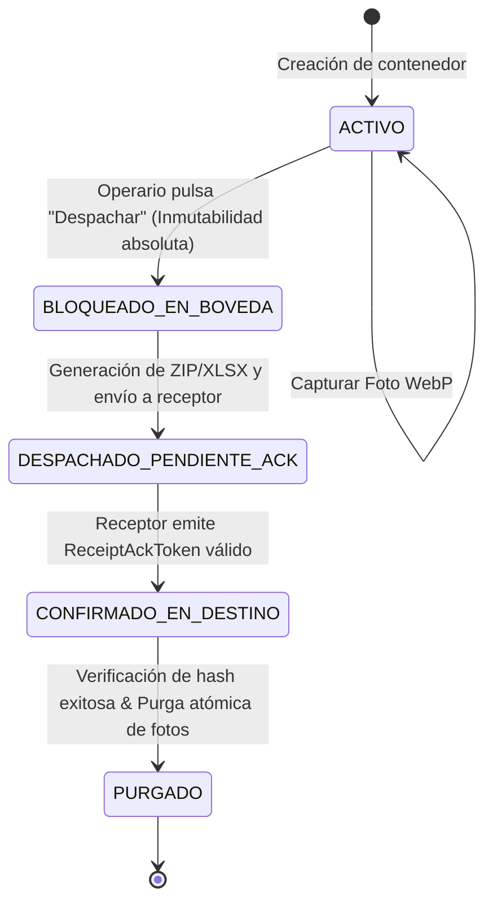

# ESPECIFICACIÓN TÉCNICA DEL DOMINIO (SDD)

## 1. TIPOS PRIMITIVOS Y DOMINIO

```typescript
export type UUID = string;
export type ISOTimestamp = string;

export type IdiomaCodigo = 'es' | 'en' | 'ru' | 'ko' | 'zh';
export type RolUsuario = 'OPERARIO' | 'SUPERVISOR' | 'ADMINISTRADOR';

export type EstadoContenedor = 
  | 'ACTIVO'
  | 'BLOQUEADO_EN_BOVEDA'
  | 'DESPACHADO_PENDIENTE_ACK'
  | 'CONFIRMADO_EN_DESTINO'
  | 'PURGADO';
```

---

## 2. ENTIDADES PRINCIPALES

### 2.1 `Operario`
Representa al usuario del sistema en patio o supervisión.
- `id: UUID`: Identificador único.
- `nombre: string`: Nombre visible en la tarjeta táctil.
- `pinHash: string`: Hash seguro del PIN de 4 dígitos calculado con PBKDF2-HMAC-SHA256 con salt local.
- `rol: RolUsuario`: Rol operativo (`OPERARIO`, `SUPERVISOR`, `ADMINISTRADOR`).
- `idiomaPreferido: IdiomaCodigo`: Idioma configurado por defecto para el operario.
- `activo: boolean`: Estado del operario en el sistema.
- `createdAt: ISOTimestamp`: Fecha y hora de creación.

### 2.2 `ItemNeumatico`
Representa una línea agrupada de neumáticos de la misma medida y marca en un contenedor.
- `id: UUID`: Identificador único del registro de acumulación.
- `contenedorId: UUID`: Clave foránea al contenedor asociado.
- `llanta: number`: Diámetro de la llanta en pulgadas (ej. 13, 14, 15, 16, 17, 18, 19, 20...).
- `ancho: number`: Anchura de la banda en milímetros (ej. 155, 165, 175, 185, 195, 205, 215, 225...).
- `perfil: number`: Relación de aspecto (ej. 40, 45, 50, 55, 60, 65, 70, 75...).
- `marca: string`: Marca comercial opcional (default: `""` o `'GENERICA'`).
- `claveCompuesta: string`: **Invariante de Dominio:** `${ancho}/${perfil}R${llanta}--${marca || 'GENERICA'}`.
- `cantidad: number`: **Invariante:** Entero estricto $\ge 1$.
- `updatedAt: ISOTimestamp`: Marca de tiempo de la última mutación.

### 2.3 `EvidenciaFoto`
Representa una captura fotográfica de pilas de ruedas o estado de la carga.
- `id: UUID`: Identificador único de la fotografía.
- `contenedorId: UUID`: Contenedor al que pertenece la evidencia.
- `rutaLocal: string`: Ruta relativa en el almacenamiento protegido del sandbox.
- `formato: 'image/webp'`: Formato de compresión obligatorio.
- `dimensionMaxPx: number`: **Invariante:** Lado mayor $\le 1280\text{ px}$.
- `pesoBytes: number`: **Invariante:** Tamaño total $< 153.600\text{ bytes}$ ($150\text{ KB}$).
- `sha256Local: string`: Checksum SHA-256 del archivo WebP resultante.
- `timestamp: ISOTimestamp`: Instante de captura y procesamiento.

### 2.4 `ProyectoContenedor`
Representa el lote / contenedor en proceso de carga o despacho.
- `id: UUID`: Identificador del contenedor.
- `codigoReferencia: string`: Código visible (ej. "Contenedor 203248").
- `operarioId: UUID`: Identificador del operario que inició o es responsable de la carga.
- `nombreOperarioSnapshot: string`: Snapshot del nombre para inmutabilidad del histórico.
- `estado: EstadoContenedor`: Estado actual según la máquina de estados FSM.
- `capacidadObjetivo?: number | null`: Aforo proyectado (ej. 1.800 ruedas) para indicador de progreso.
- `totalAcumulado: number`: **Invariante:** Suma matemática atómica de todas las `cantidad` de sus `ItemNeumatico`.
- `hashSha256Paquete?: string | null`: Checksum SHA-256 del archivo `.zip` emitido en el despacho.
- `reciboAckToken?: string | null`: Token firmado devuelto por el receptor.
- `createdAt: ISOTimestamp`: Creación del lote.
- `updatedAt: ISOTimestamp`: Última modificación.

### 2.5 `ReceiptAckToken`
Firma criptográfica emitida por la estación de recepción.
- `loteId: UUID`: Identificador del lote validado.
- `sha256Verificado: string`: Hash del paquete `.zip` verificado en destino.
- `status: 'VERIFIED'`: Estado de validación.
- `timestamp: ISOTimestamp`: Momento de emisión del acuse de recibo.
- `validadorId: UUID`: Identificador del supervisor o sistema que aprueba la carga.
- `signature: string`: Firma criptográfica del recibo.

---

## 3. MÁQUINA DE ESTADOS FINITOS (FSM) DEL CONTENEDOR


